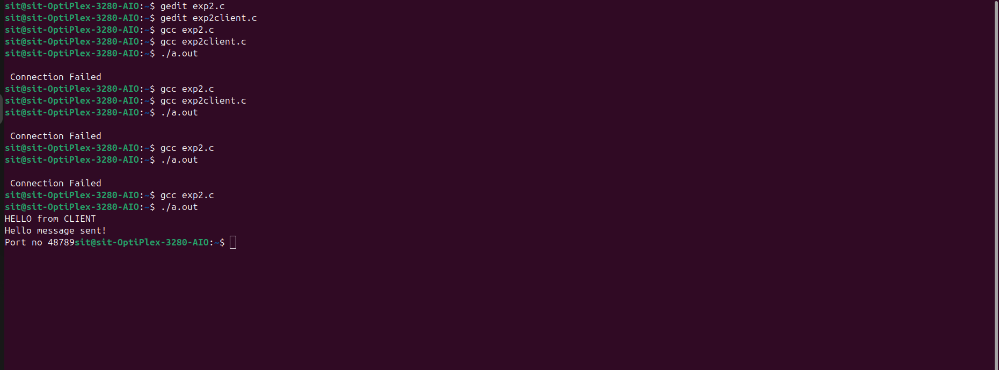
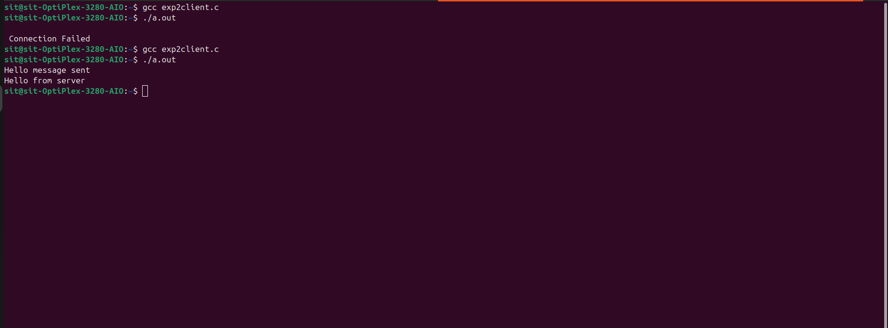
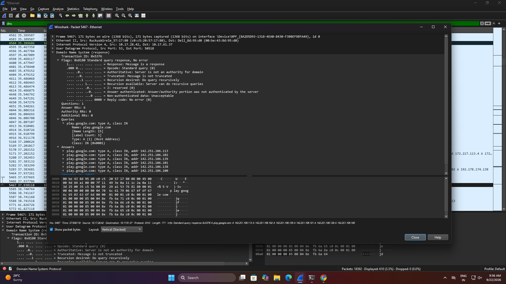
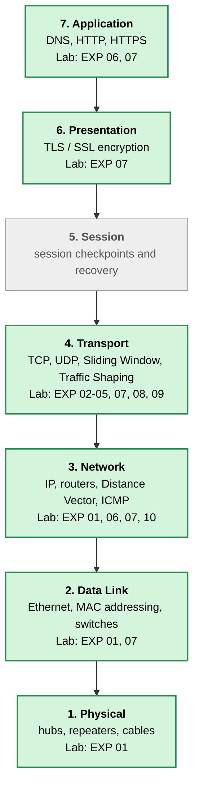
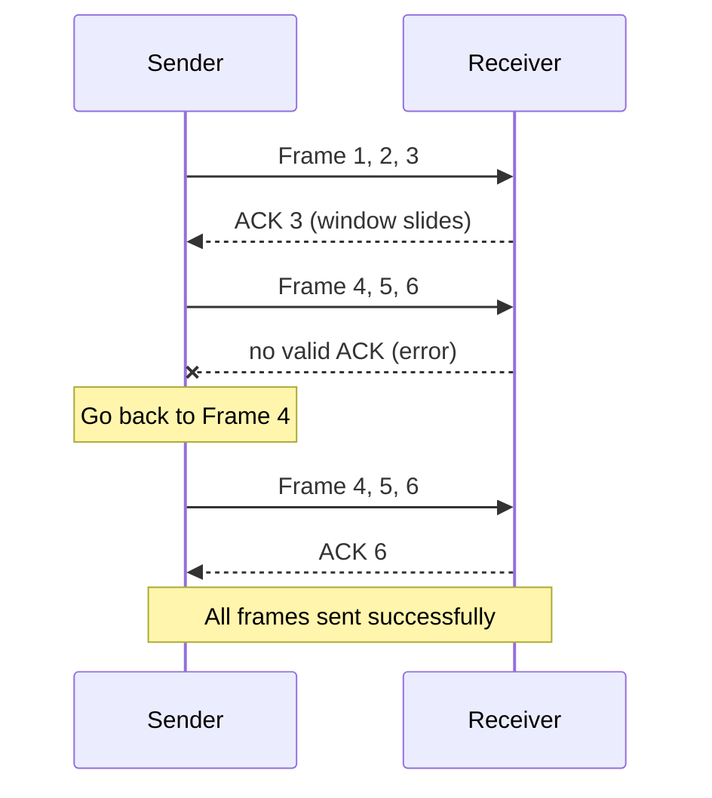
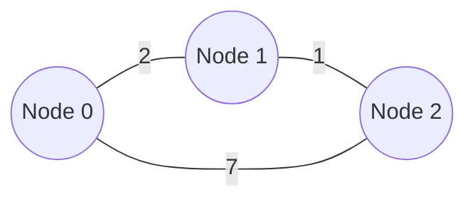

<div align="center">

# 🌐 Computer Networks Laboratory

<p>
  <strong>• Computer Networks Practical Experiments •</strong>
</p>

<p>
  
  
  
  
</p>

</div>

---

### 🔬 Computer Networks Lab

Basic networking elements → Socket programming (TCP / UDP) → DNS & ICMP diagnostics → Wireshark packet inspection → Flow control & traffic shaping → Distance vector routing

This repository contains the laboratory work for the **Computer Networks Laboratory** course. It includes practical implementations in **C (POSIX sockets)**, terminal network diagnostics and packet analysis with **Wireshark**, along with source code, execution screenshots and experiment-wise documentation.

Each experiment is organized in its own folder so that the programs, screenshots and explanations remain easy to navigate.

---

## 👨‍💻 Author

|                     |                           |
| ------------------- | ------------------------- |
| **Name**            | **Dhanish Ladwani**       |
| **PRN**             | **24070521020**           |
| **Section**         | **A**                     |
| **Batch**           | **A1**                    |
| **Course**          | **Computer Networks Lab** |

---

## 🛠️ Technologies Used

|           Technology           | Purpose                                      |
| :----------------------------: | -------------------------------------------- |
|          **C / GCC**           | Socket programming, simulation and routing   |
| **POSIX Berkeley Sockets**     | Connection-oriented TCP, connectionless UDP  |
|         **Wireshark**          | Live packet capture and protocol dissection  |
|    **Terminal Diagnostics**    | `nslookup`, `ping`, `ipconfig`, `tracert`    |
|    **Ubuntu / Linux / WSL**    | Build and execution environment              |

### Core Concepts Covered

* OSI reference model and TCP/IP protocol suite
* Hubs, switches, bridges, repeaters, routers, gateways and NICs
* Collision domains vs. broadcast domains
* Stream sockets (`SOCK_STREAM`) and the TCP three-way handshake
* Datagram sockets (`SOCK_DGRAM`) and connectionless communication
* DNS forward and reverse (PTR) lookups
* ICMP and `ping`
* Wireshark capture and display filters
* Plaintext HTTP vs. TLS / HTTPS
* Sliding Window flow control (Go-Back-N behaviour)
* Leaky Bucket and Token Bucket traffic shaping
* Distance Vector routing and the Bellman-Ford equation

---

## 📚 Experiment Index

|   No.  | Experiment                                        | Source                                   |                       Documentation                        |
| :----: | ------------------------------------------------- | ---------------------------------------- | :--------------------------------------------------------: |
| **01** | Basic Networking Elements and Devices             | —                                        | [📖 README](Experiment-01-Basic-Networking/README.md)      |
| **02** | TCP Server Socket Programming                     | `tcp_server.c`                           | [📖 README](Experiment-02-TCP-Server/README.md)            |
| **03** | TCP Client Socket Programming                     | `tcp_client.c`                           | [📖 README](Experiment-03-TCP-Client/README.md)            |
| **04** | UDP Server Socket Programming                     | `udp_server.c`                           | [📖 README](Experiment-04-UDP-Server/README.md)            |
| **05** | UDP Client Socket Programming                     | `udp_client.c`                           | [📖 README](Experiment-05-UDP-Client/README.md)            |
| **06** | DNS Commands Using Terminal                       | —                                        | [📖 README](Experiment-06-DNS-Commands/README.md)          |
| **07** | DNS and HTTPS Packet Analysis Using Wireshark     | —                                        | [📖 README](Experiment-07-Wireshark-Analysis/README.md)    |
| **08** | Sliding Window Protocol                           | `sliding_window.c`                       | [📖 README](Experiment-08-Sliding-Window/README.md)        |
| **09** | Traffic Shaping (Leaky Bucket & Token Bucket)     | `leaky_bucket.c`, `token_bucket.c`       | [📖 README](Experiment-09-Traffic-Shaping/README.md)       |
| **10** | Distance Vector Routing Algorithm                 | `distance_vector.c`                      | [📖 README](Experiment-10-Distance-Vector/README.md)       |

---

## 📂 Repository Structure

```text
Computer-Networks-Lab/
│
├── README.md
│
├── Experiment-01-Basic-Networking/
│   └── README.md
│
├── Experiment-02-TCP-Server/
│   ├── README.md
│   ├── tcp_server.c
│   └── screenshots/
│
├── Experiment-03-TCP-Client/
│   ├── README.md
│   ├── tcp_client.c
│   └── screenshots/
│
├── Experiment-04-UDP-Server/
│   ├── README.md
│   ├── udp_server.c
│   └── screenshots/
│
├── Experiment-05-UDP-Client/
│   ├── README.md
│   ├── udp_client.c
│   └── screenshots/
│
├── Experiment-06-DNS-Commands/
│   ├── README.md
│   └── screenshots/
│
├── Experiment-07-Wireshark-Analysis/
│   ├── README.md
│   └── screenshots/
│
├── Experiment-08-Sliding-Window/
│   ├── README.md
│   ├── sliding_window.c
│   └── screenshots/
│
├── Experiment-09-Traffic-Shaping/
│   ├── README.md
│   ├── leaky_bucket.c
│   ├── token_bucket.c
│   └── screenshots/
│
└── Experiment-10-Distance-Vector/
    ├── README.md
    ├── distance_vector.c
    └── screenshots/
```

---

## 📸 Preview

**TCP server output (Experiment 02)**



**TCP client output (Experiment 03)**



**DNS packet captured in Wireshark (Experiment 07)**



---

## ⚙️ Prerequisites

Install **GCC** on Ubuntu / Debian (or WSL):

```bash
sudo apt update
sudo apt install gcc
```

Verify the installation:

```bash
gcc --version
```

**Wireshark** is only needed for Experiment 07:

```bash
sudo apt install wireshark
```

---

## ▶️ Running the Experiments

### 🔹 Socket Programs: Experiments 02 – 05

These come in **server / client pairs**. Always start the **server first**, then run the client in a second terminal. Both talk over the loopback address `127.0.0.1`.

**TCP: Experiments 02 and 03 (port `8080`)**

```bash
cd Experiment-02-TCP-Server
gcc tcp_server.c -o tcp_server
./tcp_server
```

```bash
cd Experiment-03-TCP-Client
gcc tcp_client.c -o tcp_client
./tcp_client
```

**UDP: Experiments 04 and 05 (port `10004`)**

```bash
cd Experiment-04-UDP-Server
gcc udp_server.c -o udp_server
./udp_server
```

```bash
cd Experiment-05-UDP-Client
gcc udp_client.c -o udp_client
./udp_client
```

### 🔹 Standalone Simulations: Experiments 08 – 10

```bash
cd Experiment-08-Sliding-Window
gcc sliding_window.c -o sliding_window
./sliding_window
```

```bash
cd Experiment-09-Traffic-Shaping
gcc leaky_bucket.c -o leaky_bucket
gcc token_bucket.c -o token_bucket
./leaky_bucket
./token_bucket
```

```bash
cd Experiment-10-Distance-Vector
gcc distance_vector.c -o distance_vector
./distance_vector
```

### 🔹 Documentation-only Experiments: 01, 06 and 07

These experiments have no C source. Experiment 01 is a theory study, Experiment 06 uses terminal commands such as `nslookup` and `ping`, and Experiment 07 uses Wireshark captures. See their READMEs for the steps and observations.

### ⌨️ Input

The simulations read their input from **standard input**. Enter the values when prompted, or pipe them from a file:

```bash
./sliding_window < input.txt
```

---

## 🧠 How the Repository Is Organized

Each experiment follows a simple structure:

```text
Experiment
    │
    ├── Source Code
    │      └── .c
    │
    ├── Documentation
    │      └── README.md
    │
    └── Evidence
           └── screenshots/  (code and output)
```

This keeps the **implementation, explanation and execution evidence** together for every practical.

---

## 🔎 Concept Coverage

| Concept                                   | Demonstrated In          |
| ----------------------------------------- | ------------------------ |
| Network devices and OSI layers            | EXP 01                   |
| TCP stream sockets                        | EXP 02, EXP 03           |
| UDP datagram sockets                      | EXP 04, EXP 05           |
| Forward and reverse DNS lookup            | EXP 06                   |
| ICMP / `ping`                             | EXP 06                   |
| Packet capture and display filters        | EXP 07                   |
| HTTP vs. HTTPS (TLS) traffic              | EXP 07                   |
| Flow control (Sliding Window)             | EXP 08                   |
| Traffic shaping (Leaky / Token Bucket)    | EXP 09                   |
| Distance vector routing (Bellman-Ford)    | EXP 10                   |

---

## 🔄 TCP vs. UDP Workflow

Experiments 02 – 05 demonstrate the difference between connection-oriented and connectionless communication:

```text
        TCP (connection-oriented)                    UDP (connectionless)

     Server                  Client               Server              Client
       │                       │                    │                   │
    socket()                socket()             socket()            socket()
       │                       │                    │                   │
     bind()                    │                  bind()                │
       │                       │                    │                   │
    listen()                   │                    │                   │
       │   3-way handshake     │                    │                   │
    accept() <──────────── connect()           recvfrom() <────── sendto()
       │                       │                    │                   │
     read()  <───────────── send()              sendto()  ──────> recvfrom()
       │                       │                    │                   │
    send()   ───────────>   read()               close()             close()
       │                       │
    close()                 close()
```

TCP sets up a connection before any data moves. UDP just sends independent datagrams.

---

## 🗂️ Generated Files

Compiled executables are generated during the build and are **not stored in the repository**:

```text
tcp_server
tcp_client
udp_server
udp_client
sliding_window
leaky_bucket
token_bucket
distance_vector
```

---

## 📈 Learning Progress

```text
Basic Networking & Hardware Elements
                 │
                 ▼
TCP Socket Programming (Server & Client)
                 │
                 ▼
UDP Socket Programming (Server & Client)
                 │
                 ▼
Terminal Diagnostics (DNS & ICMP)
                 │
                 ▼
Wireshark Packet Capture & Analysis
                 │
                 ▼
Flow Control (Sliding Window)
                 │
                 ▼
Traffic Shaping (Leaky & Token Bucket)
                 │
                 ▼
Distance Vector Routing (Bellman-Ford)
```

---

## 🧱 The OSI Model and This Lab

Each layer works on the data handed down from the layer above. The layers highlighted in green are the ones touched by experiments in this lab.



### Example: Sliding Window with a lost frame (EXP 08)

With **6 frames** and a **window size of 3**, the sender transmits a window of frames, then is told the last frame acknowledged. If the acknowledgment does not advance the window, the sender goes back and resends from the first unacknowledged frame.



### Example: Distance Vector on a 3-node network (EXP 10)

For the cost matrix below, node 0 reaches node 2 through node 1 at cost 3, which beats the direct link of cost 7.



| Router | Destination | Next Hop | Distance |
| :----: | :---------: | :------: | :------: |
| Node 0 | 1           | 1        | 2        |
| Node 0 | 2           | 1        | 3        |
| Node 1 | 0           | 0        | 2        |
| Node 1 | 2           | 2        | 1        |
| Node 2 | 0           | 1        | 3        |
| Node 2 | 1           | 1        | 1        |

---

<div align="center">

### 🧪 Computer Networks Lab

**Socket Programming • Packet Analysis • Routing Algorithms • Network Protocols • C**

<br>

**Dhanish Ladwani**
PRN: 24070521020 • A / A1 • 2024–28

</div>
